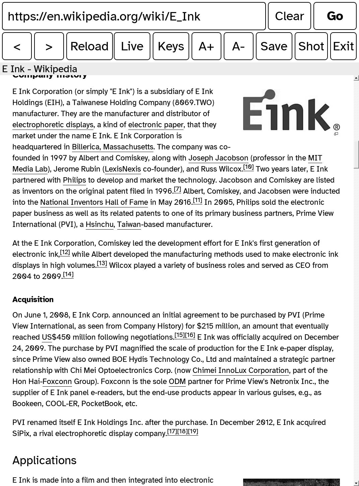

# kobo-webbrowser.koplugin

A full-screen touch web browser for Kobo e-readers, started from [KOReader](https://github.com/koreader/koreader).

It doesn't bring its own browser engine. The Kobo firmware already ships Qt 5.2.1 and
QtWebKit (Nickel uses them for its own "beta" browser), so the plugin carries a small
program that runs on those libraries and draws straight to the e-ink panel. KOReader
pauses while the browser is open and comes back when you exit.

  

## Features

- Real WebKit with JavaScript, HTTPS and cookies. Most sites that work in a 2014-era
  browser work here.
- Touch scrolling, swipe from the edges for back/forward, pinch and two-finger tap.
- On-screen keyboard that floats over the page.
- E-ink aware refresh: fast waveforms for the toolbar and keyboard, full refreshes when
  the page changes a lot.
- **Save**: turns the current article into an EPUB (Mozilla Readability plus the article's
  images) in `<KOReader home>/Web`, adds it to a KOReader collection, and can open it in the
  reader right away.
- Table of contents for long pages.
- Power button sleeps through KOReader, so you get your normal screensaver; on wake the
  browser reopens on the same page.
- Frontlight: swipe up/down along the left edge for brightness, right edge for warmth.
- KOReader's menus over the page: swipe down from the toolbar to open KOReader's top menu
  without closing the browser.
- Offline copy: if the connection is gone after a wake, you can read the saved copy of
  the page and reload once you're back online.
- Optional: type with KOReader's own keyboard (Tools → Web browser → Use KOReader
  keyboard, experimental).
- Escape hatch: hold the power button to force-quit a frozen page.

## Requirements

- A Kobo e-reader with firmware 4.x that includes Qt 5.2.1 and QtWebKit. Developed and
  tested on a **Kobo Clara BW (N365), firmware 4.46**. Other MediaTek models (Clara Colour,
  Libra Colour) are likely to work; NXP and Allwinner models are untested.
- KOReader (tested with v2026.07). The plugin uses KOReader's bundled `fbink`.

## Install

1. Download `kobo-webbrowser.koplugin-<version>.zip` from the
   [Releases](../../releases) page.
2. Connect the Kobo over USB and unzip it into `.adds/koreader/plugins/`, so you end up
   with `.adds/koreader/plugins/kobo-webbrowser.koplugin/main.lua`.
3. Eject, then restart KOReader.

### From AppStore or Storefront

If you use [AppStore](https://github.com/omer-faruq/appstore.koplugin) or
[Storefront](https://github.com/ultimatejimmy/storefront.koplugin), search for
`kobo-webbrowser`, open the latest release and install the
`kobo-webbrowser.koplugin-<version>.zip` asset. Don't use "Direct download from repo" or
"Source code": the repository holds the source, and the browser program itself is only in
the release zip.

Open it from **Tools → Web browser → Open web browser**. To put it on a gesture or a
launcher button, use the **Launch web browser** action (Gesture manager → General).

### Settings

Under **Tools → Web browser**:

- **Open address…** starts the browser on a URL you type.
- **Home page** (default `https://lite.duckduckgo.com/lite/`).
- **Collection for saved articles** (default `Web`; leave empty to skip collections).
- **Use KOReader keyboard (experimental)**.
- **Close web browser** closes a browser that is open behind KOReader's menu.
- **Show log** shows the end of the launcher log.

Advanced options are environment variables read by `bin/run.sh` (for example
`KB_AUTOSLEEP_MIN`, `KB_LIGHT_EDGE`, `KB_ESCAPE_HOLD_SEC`); see
[docs/INTERNALS.md](docs/INTERNALS.md).

### Logs

- `kobo-webbrowser.koplugin/bin/launcher.log`: each launch and its exit code.
- `kobo-webbrowser.koplugin/bin/browser.log`: the browser's own output.

## Known issues

- Google image search doesn't work yet.
- Kobo only. On other devices the menu entry shows a message and does nothing.
- The engine is the firmware's 2014-era QtWebKit: heavy modern web apps may be slow or
  fail to load.

## Coming from applauncher.koplugin

If you used the earlier setup (`.adds/kobo-browser/` launched by `applauncher.koplugin`),
remove the "Web browser" entry from `applauncher.koplugin/apps.lua` and the
`launch_kobo_browser` action from its `main.lua`, or remove that plugin entirely. This
plugin registers the same `launch_kobo_browser` action id, so existing gestures and
launcher buttons keep working. `.adds/kobo-browser/` can be deleted afterwards.

## Building

See [BUILDING.md](BUILDING.md). In short: `./build.sh` cross-compiles with NickelTC in
podman, and `./package.sh` makes the plugin folder and the release zip.

## License

AGPL-3.0-or-later (the same license as KOReader), see [LICENSE](LICENSE). Bundled and runtime third-party pieces are
listed in [THIRD_PARTY.md](THIRD_PARTY.md).

Not affiliated with Kobo or Rakuten.
